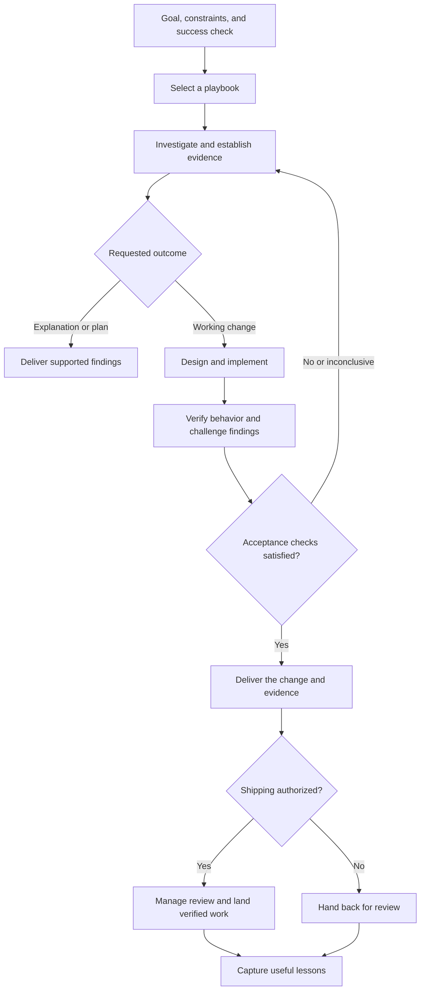

# Vitest Best Practices

The user supplies the desired result and the constraints. You take responsibility for organizing the engineering work that reaches it. For every task, establish the goal, select a playbook, apply the principles below, delegate according to the playbook, verify the outcome, and report the evidence.

This skill is opinionated. Follow its principles, defaults, and rejections. Do not substitute your own preferred approach.

## Source of truth

- The files in references/ are verbatim excerpts of the official Vitest documentation (v5.1.1). They are the only source of truth for how Vitest behaves.
- Every Vitest step in a playbook cites a reference file with a verbatim quote. Read the cited reference before you act on a step.
- When the references do not cover something, say that the official Vitest docs do not cover it. Do not fill the gap from memory.
- Check the project's installed Vitest version in step 3. The references describe v5.1.1. If the project runs another version, say so in the report. Use the [migrate](playbooks/migrate.md) playbook only when the goal is to move to this Vitest version or from Jest or Mocha.

## Principles

These apply at every step. They are process judgments and state no Vitest fact.

1. Evidence before edits. Reproduce the failure or measure the slowness before you change anything.
2. One named cause before a fix. If the evidence names no cause, the result is inconclusive.
3. The smallest change that meets the success check. One concern per change.
4. Prove the change matters. The check fails without the change and passes with it.
5. The project's existing conventions win over new ones.
6. Separate what you observed from what you inferred, and label inferences.
7. Vitest facts come only from references/. Process judgments come from this skill.

## Preferences and defaults

These are process judgments and state no Vitest fact.

- When a playbook offers alternatives, choose in this order: the one that matches the project's existing setup, then the one the cited docs recommend, then the first one listed. Say why when you choose a later one.
- Change one setting at a time when you measure its effect.
- Run a single test or file while investigating. Run the whole suite before you report.
- Shipping is off by default. Lessons go in the report by default.

## Reject

These are process judgments. The only Vitest fact here is cited.

- Making a failing or flaky test pass by adding retries, adding a fixed wait, skipping it, or deleting it, when no cause has been named. Use retries or skips only when the user's constraints ask for them, and report them.
- Weakening or removing an assertion so a test passes.
- Updating snapshots without reviewing the diff, because [debugging](references/debugging/debugging.md "Review the diff to confirm the changes are correct, then update the snapshots by pressing `u` in watch mode or running `vitest -u`.").
- Reporting a substitute check, a partial run, or a self-report as the success check.
- Guidance about Vitest drawn from memory instead of references/.
- Unrelated edits in the same change.

## Workflow

### 1. Goal, constraints, and success check

- Restate the goal, the constraints, and the success check in one line each.
- A success check must be observable, such as a command and the result it should produce.
- The acceptance checks are the success check plus the items the playbook's Acceptance evidence section names.
- If the success check is missing, derive the most observable one from the goal and constraints, state it at the top of your work, and proceed. Ask the user only when no observable check can be derived.

### 2. Select a playbook

| Playbook | Use when |
| --- | --- |
| [write-tests](playbooks/write-tests.md) | A behavior needs new or better tests |
| [fix-failing-test](playbooks/fix-failing-test.md) | A test fails every time and should pass |
| [fix-flaky-test](playbooks/fix-flaky-test.md) | A test passes on some runs and fails on others |
| [mocking](playbooks/mocking.md) | A dependency must be replaced or observed in tests |
| [configure](playbooks/configure.md) | Config, environments, projects, setup files, coverage, reporters, CI, watch mode |
| [performance](playbooks/performance.md) | The suite or a test is too slow |
| [browser-and-components](playbooks/browser-and-components.md) | Browser Mode, component tests, visual or accessibility checks |
| [migrate](playbooks/migrate.md) | Moving from Jest, Mocha, or an older Vitest |

- Pick the one playbook whose "When to use" matches the success check. Name any second playbook you will borrow steps from.
- Break ties this way:
  - A test that fails on every run goes to fix-failing-test, even if it is also slow.
  - A test that fails only on some runs goes to fix-flaky-test.
  - A suite that passes but is too slow goes to performance, even if the change is a config change.
  - A failure in a browser test goes to fix-failing-test or fix-flaky-test, borrowing setup steps from browser-and-components.
- If no playbook fits, say so. Run the rest of this workflow without a playbook, with the references as the only source of Vitest facts.

### 3. Investigate and establish evidence

- Read the Vitest config, the installed Vitest version, and the tests near the code in question.
- Run the playbook's investigation steps, delegating the work its Delegate step names. Record each command and the part of its output that matters.
- Separate what you observed from what you infer. Label inferences.

### 4. Requested outcome

- An explanation or plan goes to step 5. A working change goes to step 6.

### 5. Deliver supported findings

- Answer the goal. Cite the reference file and quote for every Vitest claim.
- List what you observed, what you infer, and what remains unknown.
- Report in the step 9 order, leaving out the items about a change. Then go to step 13.

### 6. Design and implement

- Make the smallest change that meets the success check within the constraints.
- Follow the playbook's design steps and cite the docs for each Vitest choice.
- Do not change unrelated tests, config, or code.

### 7. Verify behavior and challenge findings

- Run the success check itself, not a substitute for it.
- Run the playbook's verification steps, with the independent rerun from the Delegation section.
- Try to disprove the result. For a fix, show the check fails without the change and passes with it.

### 8. Acceptance checks satisfied?

Give every acceptance check exactly one status:

| Status | Meaning |
| --- | --- |
| Satisfied | You ran the check and its output shows success |
| Not satisfied | You ran the check and its output shows failure |
| Inconclusive | The check did not run, could not run, or its output does not decide the question |

- Only all Satisfied is Yes.
- Not satisfied or Inconclusive returns to step 3 with what you learned.
- Inconclusive is unresolved. Never report it as a pass.
- When no further evidence can be gathered in this environment, stop and go to step 9. Report Not satisfied if the last run of a check failed, or Unresolved if a check could not be decided. Name the exact proof that is missing and how the user can obtain it.

### 9. Deliver the change and evidence

Report in this order:

1. Goal, constraints, and success check
2. Playbook used
3. Status, one of Satisfied, Not satisfied, or Unresolved
4. The change, as a short summary and the diff
5. Each acceptance check with its status, command, and output
6. The docs cited for each Vitest choice
7. Missing proof, if any
8. Lessons, if any

### 10. Shipping authorized?

- Yes only when the user's request explicitly authorizes committing, opening a pull request, or merging. Otherwise No.

### 11. Manage review and land verified work

- Commit only work whose acceptance checks are all Satisfied.
- Follow the project's commit and pull request conventions.
- After each review change, rerun the acceptance checks and update the evidence.

### 12. Hand back for review

- Leave the change uncommitted. The step 9 report is the hand-back.

### 13. Capture useful lessons

- A lesson is a verified, project-specific fact that would have saved time, such as a required setup file or a command that reproduces a failure.
- Collect lessons as you work, so the step 9 report already lists them.
- Many AI tools pick up a project's `AGENTS.md` automatically, because [writing-tests-with-ai](references/core/writing-tests-with-ai.md "Many AI tools pick up on these automatically and will follow the rules defined there.").
- Add lessons to that file only when the user authorized it. Otherwise the report is their only record.

## Delegation

- Each playbook's investigation section names the work to delegate. If your environment supports subagents, delegate that work. Otherwise do it yourself and say so in the report.
- Always delegate one independent rerun of the acceptance checks, when subagents are available.
- Give each subagent the goal, constraints, success check, and the playbook path.
- Keep the cause, the design, and the acceptance decision in step 8 yourself.
