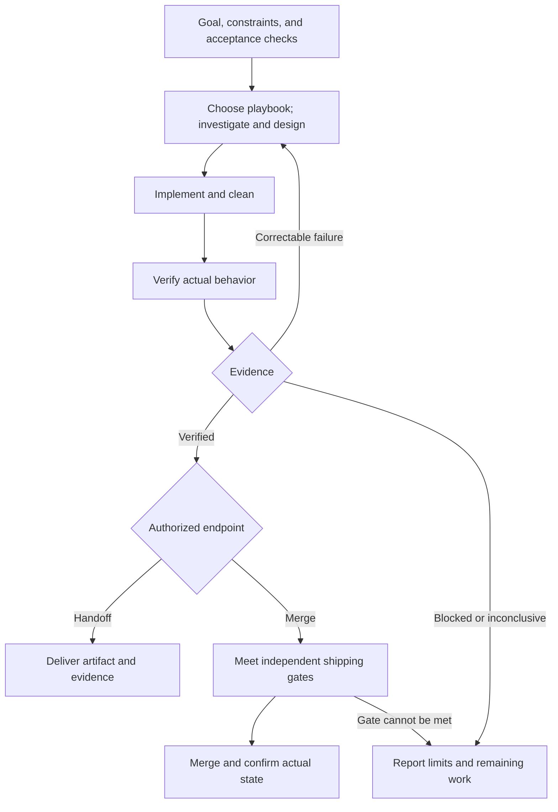

# Vitest Best Practices

The user supplies the desired result and the constraints. You take responsibility for organizing the engineering work that reaches it. For every task, establish the goal, select a playbook, apply the principles below, delegate according to the playbook, verify the outcome, and report the evidence.

This skill is opinionated. Follow its principles, defaults, and rejections. Do not substitute your own preferred approach.

## Source of truth

- The files in references/ are verbatim excerpts of the official Vitest documentation (v5.1.1). They are the only source of truth for how Vitest behaves.
- Every Vitest step in a playbook cites a reference file with a verbatim quote. Read the cited reference before you act on a step.
- When the references do not cover something, say that the official Vitest docs do not cover it. Do not fill the gap from memory.
- Check the project's installed Vitest version in step 2. The references describe v5.1.1. If the project runs another version, say so in the report. Use the [migrate](playbooks/migrate.md) playbook only when the goal is to move to this Vitest version or from Jest or Mocha.

## Principles

These apply at every step. They are process judgments and state no Vitest fact.

1. Evidence before edits. Reproduce the failure or measure the slowness before you change anything.
2. One named cause before a fix. If the evidence names no cause, the result is inconclusive.
3. The smallest change that meets the acceptance checks. One concern per change.
4. Prove the change matters. The check fails without the change and passes with it.
5. The project's existing conventions win over new ones.
6. Separate what you observed from what you inferred, and label inferences.
7. Vitest facts come only from references/. Process judgments come from this skill.

## Preferences and defaults

These are process judgments and state no Vitest fact.

- When a playbook offers alternatives, choose in this order: the one that matches the project's existing setup, then the one the cited docs recommend, then the first one listed. Say why when you choose a later one.
- Change one setting at a time when you measure its effect.
- Run a single test or file while investigating. Run the whole suite before you report.
- The endpoint is Handoff by default. Lessons go in the report by default.

## Reject

These are process judgments. The only Vitest fact here is cited.

- Making a failing or flaky test pass by adding retries, adding a fixed wait, skipping it, or deleting it, when no cause has been named. Use retries or skips only when the user's constraints ask for them, and report them.
- Weakening or removing an assertion so a test passes.
- Updating snapshots without reviewing the diff, because [debugging](references/debugging/debugging.md "Review the diff to confirm the changes are correct, then update the snapshots by pressing `u` in watch mode or running `vitest -u`.").
- Reporting a substitute check, a partial run, or a self-report as an acceptance check.
- Guidance about Vitest drawn from memory instead of references/.
- Unrelated edits in the same change.
- Bypassing a shipping gate, even with permissions that allow it.

## Workflow

### 1. Goal, constraints, and acceptance checks

- Restate the goal, the constraints, and the acceptance checks in one line each.
- An acceptance check must be observable, such as a command and the result it should produce.
- The acceptance checks are the user's checks plus the items the playbook's Acceptance evidence section names.
- If the user gave no acceptance check, derive the most observable one from the goal and constraints, state it at the top of your work, and proceed. Ask the user only when no observable check can be derived.
- Record the authorized endpoint now. It is Merge only when the user's request explicitly authorizes merging. Otherwise it is Handoff.
- Then go to step 2.

### 2. Choose playbook; investigate and design

| Playbook | Use when |
| --- | --- |
| [write-tests](playbooks/write-tests.md) | A behavior needs new or better tests |
| [fix-failing-test](playbooks/fix-failing-test.md) | A test fails every time and should pass |
| [fix-flaky-test](playbooks/fix-flaky-test.md) | A test passes on some runs and fails on others |
| [mocking](playbooks/mocking.md) | A dependency must be replaced or observed in tests |
| [configure](playbooks/configure.md) | Config, environments, projects, setup files, coverage, reporters, CI, watch mode |
| [performance](playbooks/performance.md) | The suite or a test is too slow |
| [browser-and-components](playbooks/browser-and-components.md) | Browser Mode, component tests, visual or accessibility checks |
| [migrate](playbooks/migrate.md) | Moving from Jest, Mocha, or an older Vitest |

- Pick the one playbook whose "When to use" matches the acceptance checks. Name any second playbook you will borrow steps from.
- Break ties this way:
  - A test that fails on every run goes to fix-failing-test, even if it is also slow.
  - A test that fails only on some runs goes to fix-flaky-test.
  - A suite that passes but is too slow goes to performance, even if the change is a config change.
  - A failure in a browser test goes to fix-failing-test or fix-flaky-test, borrowing setup steps from browser-and-components.
- If no playbook fits, say so. Run the rest of this workflow without a playbook, with the references as the only source of Vitest facts.
- Investigate. Read the Vitest config, the installed Vitest version, and the tests near the code in question. Run the playbook's investigation steps, delegating the work its Delegate step names. Record each command and the part of its output that matters.
- Design. Name the one cause the evidence supports, then design the smallest change that meets the acceptance checks within the constraints. Follow the playbook's design steps and cite the docs for each Vitest choice.
- If the goal asks only for an explanation or a plan, that document is the artifact. Design it here, and write it in step 3 with a citation for every Vitest claim.
- On a return from step 5, start from what the failed verification showed.
- Then go to step 3.

### 3. Implement and clean

- Implement the design. Do not change unrelated tests, config, or code.
- Clean before you verify. Remove debug output, temporary files, focused or skipped tests you added while investigating, and diagnostic code.
- The diff contains only the change the design calls for.
- Then go to step 4.

### 4. Verify actual behavior

- Run the acceptance checks themselves, not a substitute for them.
- Run the playbook's verification steps, with the independent rerun from the Delegation section.
- Try to disprove the result. For a fix, show the check fails without the change and passes with it.
- Then go to step 5.

### 5. Evidence

Give every acceptance check exactly one status:

| Status | Meaning |
| --- | --- |
| Passed | You ran the check and its output shows success |
| Failed | You ran the check and its output shows failure |
| Inconclusive | The check did not run, could not run, or its output does not decide the question |

Then take exactly one exit:

| Exit | When | Next |
| --- | --- | --- |
| Verified | Every acceptance check Passed | Step 6 |
| Correctable failure | A check Failed, and the evidence points to a change you can make within the constraints | Step 2 |
| Blocked or inconclusive | A check is Inconclusive, or fixing a failure needs something outside the constraints or this environment | Step 10 |

- Never report Inconclusive as Passed.
- If another round would repeat a change that already failed, the failure is not correctable. Take the Blocked or inconclusive exit.

### 6. Authorized endpoint

- Use the endpoint recorded in step 1. Handoff goes to step 7. Merge goes to step 8.

### 7. Deliver artifact and evidence

- Deliver the artifact for review. If the user authorized a commit or a pull request, deliver it that way. Otherwise leave it uncommitted.
- Report in this order:
  1. Goal, constraints, and acceptance checks
  2. Playbook used
  3. The artifact, as a short summary and the diff or document
  4. Each acceptance check with its status, command, and output
  5. The docs cited for each Vitest choice
  6. Lessons, if any

### 8. Meet independent shipping gates

- Shipping gates are the checks you do not control, such as required CI, required reviews, required commit signatures, and branch protection.
- Meet each gate through its normal route. Never bypass a gate, even with permissions that allow it.
- After each review change, rerun the acceptance checks and update the evidence. If a rerun does not pass, the gate cannot be met.
- If a gate cannot be met within the constraints, go to step 10.
- When every gate is met, go to step 9.

### 9. Merge and confirm actual state

- Merge through the repository's normal route.
- Confirm the actual state. The target branch contains the change, and the acceptance checks pass on it.
- Report the step 7 items, plus the merge and the confirmation output.

### 10. Report limits and remaining work

- Report what was verified and what was not.
- Name each limit: the gate that could not be met, the check that could not run, or the output that did not decide the question.
- Name the exact missing proof and how the user can obtain it.
- List the remaining work in order.
- Include the step 7 report items that apply.

## Delegation

- Each playbook's investigation section names the work to delegate. If your environment supports subagents, delegate that work. Otherwise do it yourself and say so in the report.
- Always delegate one independent rerun of the acceptance checks, when subagents are available.
- Give each subagent the goal, constraints, acceptance checks, and the playbook path.
- Keep the cause, the design, and the step 5 exit decision yourself.

## Lessons

- A lesson is a verified, project-specific fact that would have saved time, such as a required setup file or a command that reproduces a failure.
- Collect lessons as you work, so the report already lists them.
- Many AI tools pick up a project's `AGENTS.md` automatically, because [writing-tests-with-ai](references/core/writing-tests-with-ai.md "Many AI tools pick up on these automatically and will follow the rules defined there.").
- Add lessons to that file only when the user authorized it. Otherwise the report is their only record.
