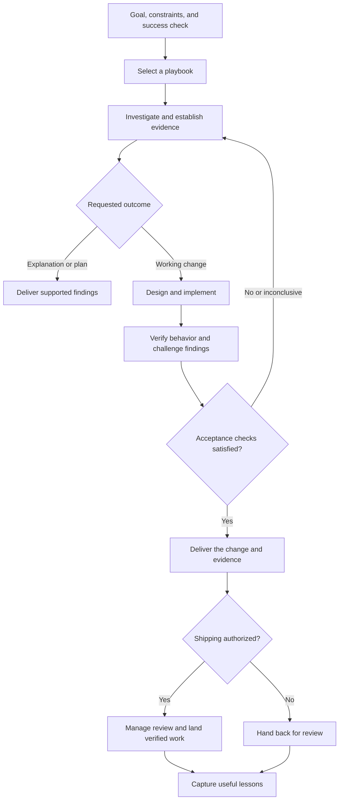

# Vitest Best Practices

The user directs the outcome. This skill coordinates the process. The user gives a goal, constraints, and a way to recognize success. You select a playbook, investigate, make the smallest well-supported change, check the actual result, and bring back evidence the user can review.

## Source of truth

- The files in references/ are verbatim excerpts of the official Vitest documentation (v5.1.1). They are the only source of truth for how Vitest behaves.
- Every Vitest step in a playbook cites a reference file with a verbatim quote. Read the cited reference before you act on a step.
- When the references do not cover something, say that the official Vitest docs do not cover it. Do not fill the gap from memory.
- Check the project's installed Vitest version first. The references describe v5.1.1. If the project runs another version, say so in the report. Use the [migrate](playbooks/migrate.md) playbook only when the goal is to upgrade.

## Workflow

### 1. Goal, constraints, and success check

- Restate the goal, the constraints, and the success check in one line each.
- A success check must be observable, such as a command and the result it should produce.
- If the success check is missing or cannot be observed, propose one. Investigate meanwhile, but do not start Design and implement until the user accepts it.

### 2. Select a playbook

| Playbook | Use when |
| --- | --- |
| [write-tests](playbooks/write-tests.md) | A behavior needs new or better tests |
| [fix-failing-test](playbooks/fix-failing-test.md) | A test fails every time and should pass |
| [fix-flaky-test](playbooks/fix-flaky-test.md) | A test passes on some runs and fails on others |
| [mocking](playbooks/mocking.md) | A dependency must be replaced or observed in tests |
| [configure](playbooks/configure.md) | Config, environments, projects, setup files, coverage, reporters, CI, watch mode |
| [performance](playbooks/performance.md) | The suite or a test is too slow |
| [browser-and-components](playbooks/browser-and-components.md) | Browser Mode, component tests, visual or accessibility checks |
| [migrate](playbooks/migrate.md) | Moving from Jest, Mocha, or an older Vitest |

- Pick the one playbook whose "When to use" matches the success check. Name any second playbook you will borrow steps from.
- If no playbook fits, say so and continue with the references as the only source.

### 3. Investigate and establish evidence

- Read the Vitest config, the installed Vitest version, and the tests near the code in question.
- Run the playbook's investigation steps. Record each command and the part of its output that matters.
- Separate what you observed from what you infer. Label inferences.

### 4. Requested outcome

- An explanation or plan goes to step 5. A working change goes to step 6.

### 5. Deliver supported findings

- Answer the goal. Cite the reference file and quote for every Vitest claim.
- List what you observed, what you infer, and what remains unknown.

### 6. Design and implement

- Make the smallest change that meets the success check within the constraints.
- Follow the playbook's design steps and cite the docs for each Vitest choice.
- Do not change unrelated tests, config, or code.

### 7. Verify behavior and challenge findings

- Run the success check itself, not a substitute for it.
- Run the playbook's verification steps.
- Try to disprove the result. For a fix, show the check fails without the change and passes with it.

### 8. Acceptance checks satisfied?

Give every acceptance check exactly one status:

| Status | Meaning |
| --- | --- |
| Satisfied | You ran the check and its output shows success |
| Not satisfied | You ran the check and its output shows failure |
| Inconclusive | The check did not run, could not run, or its output does not decide the question |

- Only all Satisfied is Yes.
- Not satisfied or Inconclusive returns to step 3 with what you learned.
- Inconclusive is unresolved. Never report it as a pass.
- When no further evidence can be gathered in this environment, stop and hand back with status Unresolved. Name the exact proof that is missing and how the user can obtain it.

### 9. Deliver the change and evidence

Report in this order:

1. Goal, constraints, and success check
2. Playbook used
3. Status, one of Satisfied, Not satisfied, or Unresolved
4. The change, as a short summary and the diff
5. Each acceptance check with its status, command, and output
6. The docs cited for each Vitest choice
7. Missing proof, if any
8. Lessons, if any

### 10. Shipping authorized?

- Yes only when the user's request explicitly authorizes committing, opening a pull request, or merging. Otherwise No.

### 11. Manage review and land verified work

- Commit only work whose acceptance checks are all Satisfied.
- Follow the project's commit and pull request conventions.
- After each review change, rerun the acceptance checks and update the evidence.

### 12. Hand back for review

- Leave the change uncommitted and deliver the report from step 9.

### 13. Capture useful lessons

- A lesson is a verified, project-specific fact that would have saved time, such as a required setup file or a command that reproduces a failure.
- Many AI tools pick up a project's `AGENTS.md` automatically, because [writing-tests-with-ai](references/core/writing-tests-with-ai.md "Many AI tools pick up on these automatically and will follow the rules defined there.").
- Add lessons to that file only when the user authorized it. Otherwise list them in the report.

## Delegation

- If your environment supports subagents, delegate read-only investigation of large areas and an independent rerun of the acceptance checks.
- Give each subagent the goal, constraints, success check, and the playbook path.
- Keep the acceptance decision in step 8 yourself.
